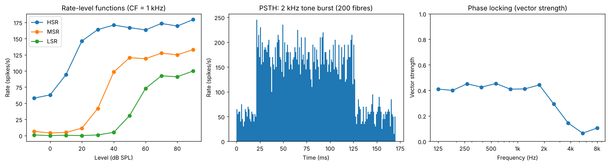
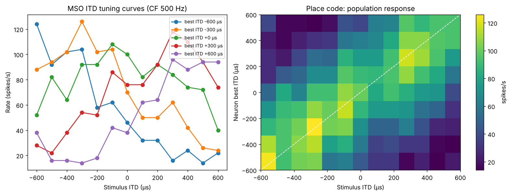
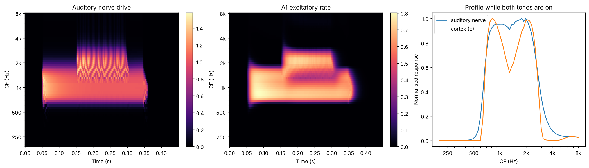

# Auditory Neuroscience Brain Simulation

A modular, hackable simulation of the mammalian auditory pathway, from sound waves
to cortex, plus PyTorch neural networks (CNNs and spiking networks) trained on the
simulated auditory nerve output. It is built for learning and as a starting point
for your own computational-neuroscience projects.

```
 sound (Pa)
   │
   ▼
 ┌────────────────────┐  cochlea.py
 │ Basilar membrane   │  4th-order gammatone filterbank on the ERB scale (tonotopy)
 │ Inner hair cells   │  rectifying, saturating MET channel + membrane low-pass
 └────────────────────┘
   │
   ▼
 ┌────────────────────┐  auditory_nerve.py
 │ Auditory nerve     │  HSR / MSR / LSR fibres, adaptation, refractoriness,
 │                    │  stochastic spikes, phase locking
 └────────────────────┘
   │
   ▼
 ┌────────────────────┐  brainstem.py
 │ Cochlear nucleus   │  bushy cells (ANF convergence → sharper phase locking)
 │ Superior olive     │  Jeffress MSO coincidence-detector array (ITD → place code)
 └────────────────────┘
   │
   ▼
 ┌────────────────────┐  cortex.py
 │ Auditory cortex A1 │  tonotopic Wilson-Cowan E/I network, lateral inhibition
 └────────────────────┘
   │
   ▼
 ┌────────────────────┐  nn/
 │ Neural networks    │  CochleagramCNN, SpikingAuditoryNet (surrogate gradients),
 │                    │  synthetic pitch-identification task
 └────────────────────┘
```

## Quick start

```bash
pip install -r requirements.txt      # or: pip install -e ".[torch,dev]"
python -m pytest                     # 16 tests, about 10 s

cd examples
python 01_peripheral_processing.py        # sound → BM → IHC → auditory nerve
python 02_auditory_nerve_physiology.py    # rate-level, PSTH, phase locking
python 03_sound_localization_jeffress.py  # ITD coding in the MSO
python 04_tonotopic_cortex.py             # E/I tonotopic cortex, lateral inhibition
python 05_train_pitch_networks.py --model cnn   # deep net learns pitch (~1 min, CPU)
python 05_train_pitch_networks.py --model snn   # spiking net learns pitch (~1.5 min)
```

Figures are written to `outputs/`. Reference copies are in `docs/figures/`.

```python
import auditory_sim as A
from auditory_sim import stimuli

fs = 32000
sound = stimuli.harmonic_complex(f0=200, duration=0.3, fs=fs, level_db=65)
per = A.AuditoryPeriphery(fs, n_channels=64, f_min=100, f_max=8000)
out = per.process(sound)                    # out.bm, out.ihc, out.rate  (channels × time)
spikes = per.spikes(out.rate, n_fibers=10)  # bool (channels × fibres × time)
cfs, t, C = A.cochleagram(sound, fs)        # NN-ready auditory spectrogram
```

## What the simulation reproduces

| Phenomenon | Where | Example |
|---|---|---|
| Tonotopy, ERB-scaled frequency selectivity | `cochlea.GammatoneFilterbank` | 01 |
| Resolved vs unresolved harmonics | gammatone bandwidths | 01 |
| Saturating rate-level functions, 3 SR classes with staggered thresholds | `cochlea.InnerHairCell` + `auditory_nerve` | 02 |
| Onset peak and adaptation in the PSTH | `AuditoryNerve.rate` | 02 |
| Phase locking that rolls off above about 2 kHz | IHC low-pass | 02 |
| Enhanced synchrony in bushy cells | `brainstem.BushyCells` | tests |
| ITD place code (Jeffress model) | `brainstem.JeffressMSO` | 03 |
| Lateral suppression and sharpened tonotopic tuning | `cortex.TonotopicCortex` | 04 |
| Pitch from harmonic structure, incl. missing fundamental | `nn.datasets`, `nn.models` | 05 |

<p>



</p>

## Package layout

```
auditory_sim/
  stimuli.py         tones, AM, harmonic complexes, noise, clicks, chirps, ITD/ILD (calibrated in dB SPL)
  cochlea.py         ERB scale, gammatone filterbank, inner hair cell
  auditory_nerve.py  ANF rate model + spike generator with refractoriness
  periphery.py       AuditoryPeriphery pipeline + cochleagram()
  neurons.py         LIF and Izhikevich populations, exponential synapses, delays
  brainstem.py       bushy cells, Jeffress MSO
  cortex.py          tonotopic Wilson-Cowan cortex
  analysis.py        PSTH, vector strength, period/ISI histograms, firing rate
  plotting.py        cochleagram/raster helpers
  nn/                PyTorch: models.py, datasets.py, train.py
examples/            runnable tutorials 01–05
tests/               pytest suite
```

## Modelling choices and limitations

The models are deliberately simple so every line is readable and easy to modify.
Known simplifications, each a good first project:

- **Linear cochlea.** There is no outer-hair-cell amplifier, so no level-dependent
  tuning, compression or two-tone suppression. Try a DRNL filterbank
  (Meddis et al., 2001) or swap in the Zilany-Bruce-Carney model (e.g. via the
  `cochlea` PyPI package).
- **Phase locking is weaker than in real fibres** (vector strength about 0.45 at
  1 kHz; real fibres reach about 0.8), because spontaneous spikes are not
  suppressed during the inhibitory half-cycle. A Boltzmann MET function with a
  resting open probability (spontaneous activity that is modulated, not added)
  would fix this.
- **Fibre-class thresholds** are lumped into the IHC sensitivity, not modelled at
  the ribbon synapse.
- **The MSO uses excitation only.** Real MSO neurons also get precisely timed
  glycinergic inhibition (MNTB/LNTB), which shifts best ITDs (Brand et al., 2002).
  The LSO/ILD pathway is not implemented yet.
- **IC and MGB are skipped.** Cortex is driven directly by the auditory nerve rate.

## Ideas to develop next

1. **Neural-data comparison**: probe hidden units of the trained CNN/SNN for F0
   tuning, harmonicity or spectrotemporal receptive fields (reverse correlation
   with `stimuli.white_noise`), and compare with A1 recordings.
2. **Feed spikes, not spectrograms, to the SNN**: use `per.spikes(...)` as input
   so the network can use temporal (phase-locked) codes.
3. **Sound localisation network**: generate binaural stimuli with `apply_itd` /
   `apply_ild` and train a network to decode azimuth. Compare with the Jeffress array.
4. **Hearing loss**: lower IHC sensitivity (`ihc_kwargs={"p50": ...}`), remove
   fibres (synaptopathy), and measure how the trained networks degrade.
5. **Plasticity**: add STDP to `neurons.py` and let MSO delays or cortical
   tonotopy self-organise.
6. **Real sounds**: load speech or music with `scipy.io.wavfile`, scale with
   `stimuli.set_level`, and train on vowel or speaker identification.

## Key references

- Glasberg & Moore (1990). Derivation of auditory filter shapes from notched-noise data. *Hear Res.*
- Patterson et al. (1992). Complex sounds and auditory images.
- Zilany, Bruce & Carney (2014). Updated parameters and expanded simulation options for a model of the auditory periphery. *JASA.*
- Jeffress (1948). A place theory of sound localization. *J Comp Physiol Psychol.*
- Joris, Carney, Smith & Yin (1994). Enhancement of neural synchronization in the anteroventral cochlear nucleus. *J Neurophysiol.*
- Wilson & Cowan (1972). Excitatory and inhibitory interactions in localized populations of model neurons. *Biophys J.*
- Zenke & Ganguli (2018). SuperSpike: supervised learning in multilayer spiking neural networks. *Neural Comput.*
- Kell et al. (2018). A task-optimized neural network replicates human auditory behavior. *Neuron.*
- Saddler, Gonzalez & McDermott (2021). Deep neural network models reveal interplay of peripheral coding and stimulus statistics in pitch perception. *Nat Commun.*
